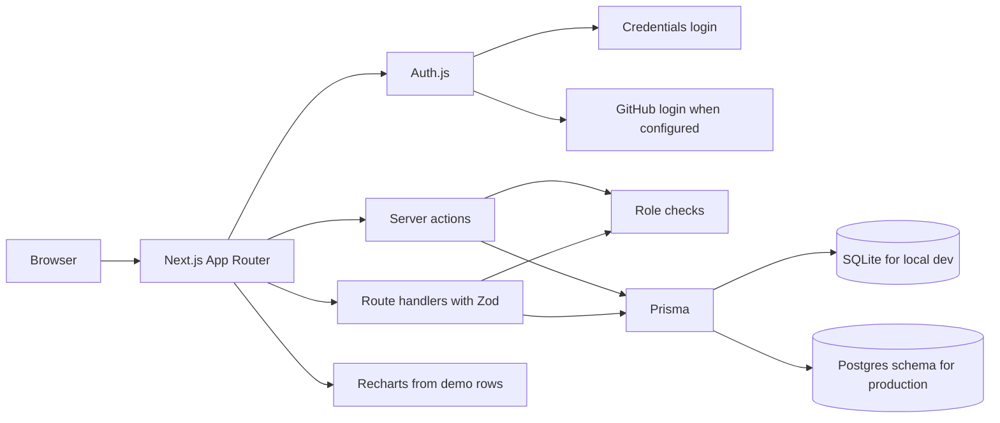

# Signalboard

Signalboard is a portfolio demo of a SaaS analytics dashboard. It is a Next.js app for organisations, projects, and product events, with role-based access and charts. The charts are computed from seeded rows and from events you add in the demo. They are not production metrics.

This is a portfolio demo by Arpan Bom. It is not a real analytics product, and it does not call paid APIs.

## Architecture



Credentials login works with the seeded accounts. GitHub login is wired through Auth.js and stays off until `AUTH_GITHUB_ID` and `AUTH_GITHUB_SECRET` are set. No API keys are included.

Local development and the test suite use SQLite. `prisma/schema.postgres.prisma` is the same model set with the Postgres provider, for a later production database.

Roles:

- **Owner** manages members and can change projects and events.
- **Admin** can change projects and events.
- **Viewer** can read.

## Run it

```bash
npm install
cp .env.example .env
npx prisma db push
npm run db:seed
npm run dev -- -p 43123
```

Open http://127.0.0.1:43123.

`npm run db:seed` resets the local SQLite file and loads the demo organisations. The shared password is `demo-password`.

| Email | Access |
| --- | --- |
| mira@signalboard.dev | Owner at Northline, admin at Harbor |
| owen@signalboard.dev | Admin at Northline |
| priya@signalboard.dev | Viewer at Northline, owner at Harbor |

Seeded projects and events are labeled **Sample data** or **Seeded demo project**. Events you create in the app are labeled **Recorded in demo**. Retention, revenue, and conversion are shown as not measured.

To point the app at Postgres later, replace `prisma/schema.prisma` with `prisma/schema.postgres.prisma`, set `DATABASE_URL` to a Postgres connection string, and run `npx prisma db push` again.

## Test it

```bash
npm test
```

That runs Vitest unit tests for the role checks, validation, analytics totals, and server command logic, plus React Testing Library tests for the sample-data label, KPI placeholder, role badge, and theme control.

Lint, types, and a production build:

```bash
npm run lint
npm run typecheck
npm run build
```

GitHub Actions (`.github/workflows/ci.yml`) runs lint, typecheck, test, and build.

## License

MIT. See [LICENSE](LICENSE).
